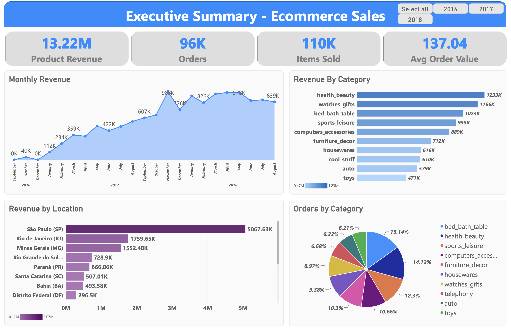
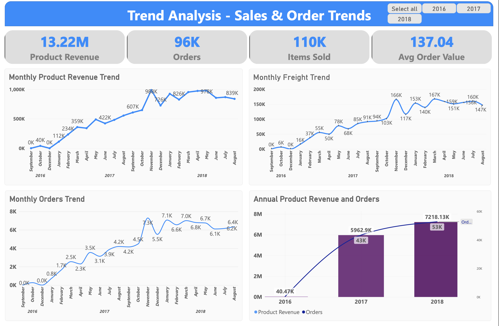
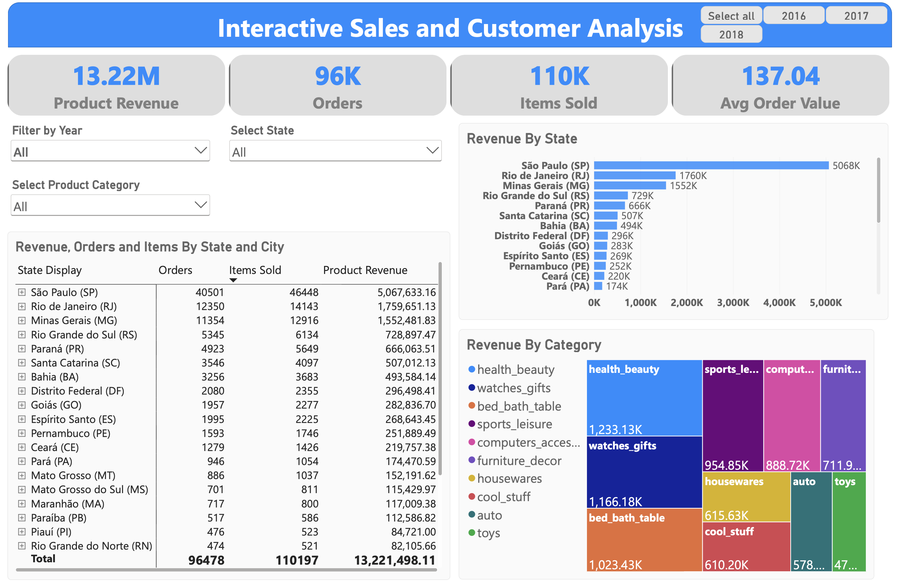

# Olist E-Commerce Sales Performance Analytics

##  Executive Overview

An end-to-end Data Warehouse and Business Intelligence solution analyzing delivered sales performance across purchase timelines, product categories, and geographical regions using the **Brazilian E-Commerce Public Dataset by Olist (2016–2018)**.

---

## Executive Summary & Key Metrics

The solution integrates 6 operational CSV sources into Microsoft SQL Server, executes a declarative ETL pipeline into a star schema, refreshes two aggregated data marts, and delivers analytical dashboards in Power BI.

| Metric | Validated Value | Description |
| :--- | :--- | :--- |
| **Total Product Revenue** | **13,221,498.11** | Net merchandise sales value |
| **Total Freight Charges** | **2,198,275.64** | Total shipping charges collected |
| **Delivered Orders** | **96,478** | Unique customer orders completed |
| **Items Sold** | **110,197** | Distinct order line-items delivered |
| **Average Order Value (AOV)** | **137.04** | Mean basket revenue per order |

---

## Dimensional Model (Star Schema)

The warehouse is designed as a **Star Schema** optimized for high-performance slice-and-dice queries and Power BI DAX calculations.

### Business Process and Grain
- **Business Process**: E-commerce Order Item Delivery & Fulfillment.
- **Grain**: **One record per delivered order item** 

### Table Definitions

#### Fact Table: `FactSales`

#### Dimension Tables
1. **`DimCustomer`**
2. **`DimProduct`**
3. **`DimSeller`**
4. **`DimLocation`**
5. **`DimDate`**
---

### Data Marts

Two aggregated summary tables were designed in the `SalesMart` schema to accelerate recurring analytical reporting without querying the granular fact table:

#### 1. `SalesMart.MonthlyRegionalSales`
Aggregates sales performance by purchase month and customer state.
- **Use Case**: Regional performance tracking, logistics planning, and state-level market share.

#### 2. `SalesMart.MonthlyCategorySales`
Aggregates sales performance by purchase month and product category.
- **Use Case**: Category demand forecasting, inventory reorder planning, and category revenue share over time.


---

## Power BI Dashboards

### 1. Executive Summary


### 2. Sales & Order Trends


### 3. Interactive Sales & Customer Analysis



---

## Key Findings & Business Insights

1. **Seasonality & Demand Peaks**:
   - **November 2017 Peak**: Massive spike in revenue (~1.19M) and orders (>8,500) driven by Black Friday promotions.
   - **December Retraction**: Immediate dip to ~878K following November due to campaign cessation and shipping lead time constraints.
2. **Heavy Geographic Concentration**:
   - **São Paulo (SP)**: 5,067,633.16 (38.3% of total revenue)
   - **Rio de Janeiro (RJ)**: 1,759,651.13 (13.3% of total revenue)
   - Together, SP and RJ account for **51.6% of national revenue**. The South & Southeast regions generate over 70% of total GMV.
3. **Leading Product Categories (25.9% of Revenue)**:
   - **Health & Beauty** (`health_beauty`): **1,233,131.72** (9,670 orders)
   - **Watches & Gifts** (`watches_gifts`): **1,166,176.98** (5,991 orders, high ticket item)
   - **Bed, Bath & Table** (`bed_bath_table`): **1,023,434.76** (11,115 items sold, volume leader)
4. **Logistics Burden & Basket Composition**:
   - **Freight Ratio**: Total freight of **2.20M** accounts for **16.6%** of total product revenue (~22.78 per order).
   - **Basket Size**: An average of **1.14 items per order** reveals that most orders are single-item purchases, indicating high opportunity for bundle discounts.

---

## Strategic Recommendations

- **Q4 Supply Chain Buffering**: Begin warehouse stocking and partner logistics reservations in September–October to mitigate bottlenecks observed during November sales surges.
- **Tailored Category Strategy**: Apply multi-item bundling to high-volume goods (`bed_bath_table`) to increase basket size, while offering premium warranties for higher-ticket items (`watches_gifts`).
- **Regional Hub Expansion**: Establish fulfillment centers closer to São Paulo and Rio de Janeiro to lower freight expenses and accelerate last-mile delivery for over half of all orders.

---

## Project Structure

```text
├── Power BI/          <- Power BI report
├── SQL files/         <- Database schema, ETL & datamartscripts
├── Dataset.txt        <- Kaggle dataset source link
├── images/            <- Dashboard screenshot previews
├── .gitignore        
└── README.md         
```
